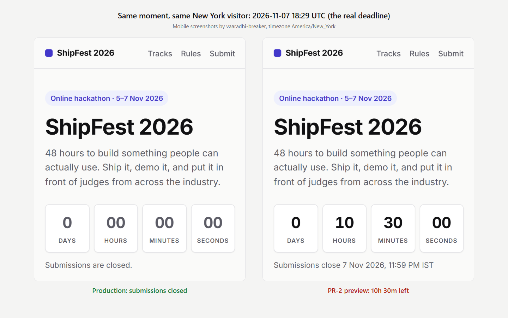
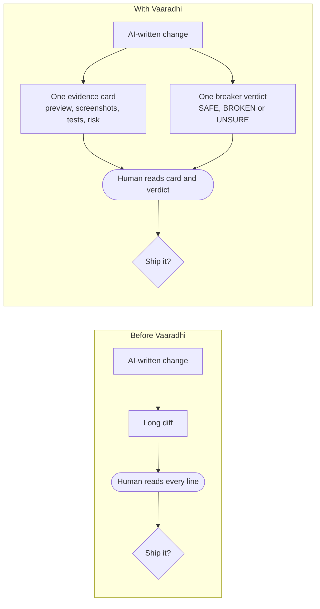
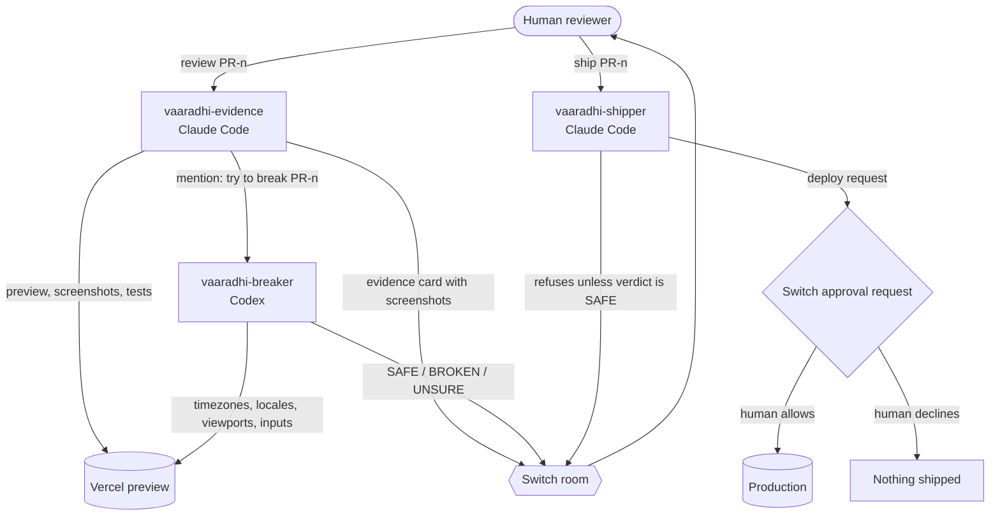
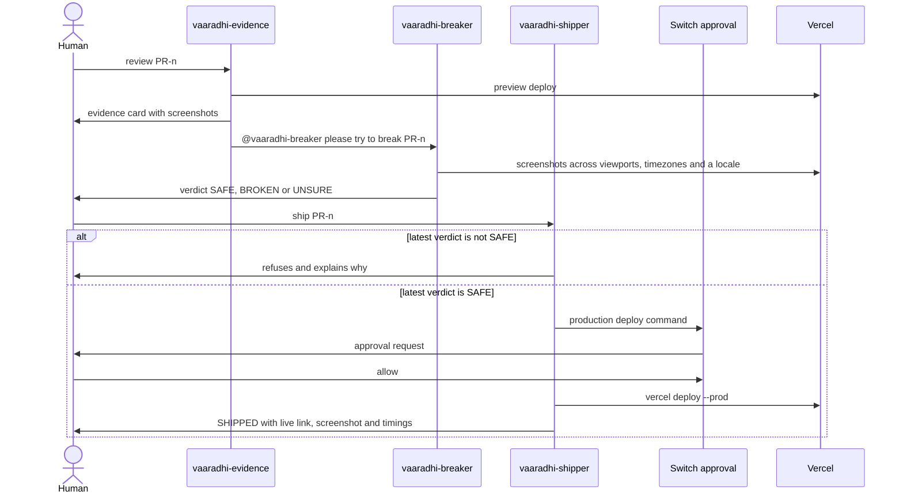
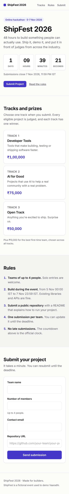
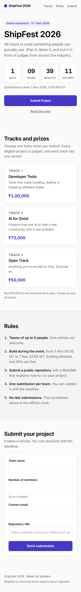

# Vaaradhi

**Reviewers check proof instead of reading AI-written diffs.**

Vaaradhi is a Switch room with three agents. One runs each AI-written change and posts evidence, a second agent from a different AI vendor tries to break it, and a third ships it only when a human asks and approves. The name means "bridge" in Telugu. Built for the Flip the Switch hackathon (WeMakeDevs x Switch AI).

## At a glance

- **Broken change caught:** in 2 of 2 runs (PR-2)
- **Broken changes shipped:** 0
- **Tests that caught PR-2:** 0 of 12
- **False alarms:** 1 in Run 1, 0 in Run 2
- **Run 2 human decision time:** 72 to 139 seconds
- **Run 2 review to live:** 5:13 to 8:31



*At the real deadline, production correctly says submissions are closed, but a New York visitor on the PR-2 preview sees 10h 30m left. All 12 tests passed.*

## The problem

We checked each figure below against the linked page on 5 Nov 2026.

- **Harvard study of about 700 firms:** 30 percent more code and 23 percent more pull requests, but no more finished work, and review time up 49 percent. As reported by [Dromeas](https://dromeas.ai/blog/ai-coding-agents-code-review-bottleneck).
- **Qodo:** its [State of AI Code Quality 2026](https://www.qodo.ai/blog/state-of-ai-code-quality-report-2026/) report names reviewing AI-generated code as the top bottleneck for developers and engineering leaders.
- **Faros AI and DORA:** [QA.tech](https://qa.tech/blog/code-review-bottleneck-ai-generated-code) cites Faros AI data showing median review taking five times longer, and discusses the DORA "verification tax".
- **InfoQ, October 2026:** [35 percent of generated code reaches production before the team understands it](https://www.infoq.com/news/2026/10/survey-complex-codebases-agents/).
- **Stack Overflow 2025 Developer Survey:** 66 percent of developers named "AI solutions that are almost right, but not quite" as their biggest frustration. As reported by [admin-it](https://www.admin-it.io/stack-overflow-survey-66-of-developers-frustrated-by-ai-inaccuracy/). PR-2 in our demo is exactly that kind of change.
- **The gap:** a diff tells a reviewer what changed. It does not tell them whether the change works for every user.



## How it works



One PR from start to finish:



### The three agents

**vaaradhi-evidence** (Claude Code)
- **Trigger:** a person says `review PR-n`.
- **What it does:** copies the live site, applies the change, runs `node --test`, deploys a Vercel preview, and screenshots preview and production on mobile and desktop.
- **Output:** one evidence card with the claim, what actually changed in plain language, files touched, test results, preview link, before and after screenshots, a LOW, MEDIUM or HIGH risk with one reason, and the time taken. Then it mentions the breaker.
- **Guardrail:** never deploys to production, never edits the live site folder, never reads outside its workspace.

**vaaradhi-breaker** (Codex)
- **Trigger:** mentioned with a PR number and a preview URL.
- **What it does:** tries to break the change. It compares preview and production at mobile 390x844 and desktop 1440x900, in at least three timezones and one non-English locale, and checks form edge inputs against the form's HTML constraints and validation code.
- **Output:** a verdict that starts with SAFE, BROKEN or UNSURE, with screenshots and plain-language steps to reproduce.
- **Guardrail:** never deploys, writes only to its own `shots` folder, and follows a severity rubric. BROKEN only for realistic failures that cause harm; theoretical edge cases go in "Minor notes" under SAFE.

**vaaradhi-shipper** (Claude Code)
- **Trigger:** only the exact human message `ship PR-n`.
- **What it does:** checks the change was reviewed and the breaker's latest verdict starts with SAFE, backs up the live site, applies the change, and runs the production deploy behind the Switch approval request.
- **Output:** a SHIPPED message with the live link, a fresh screenshot, the review to live time and the human decision time.
- **Guardrail:** refuses on BROKEN, UNSURE or no verdict. Only its owner can talk to it, auto mode is off, and a ship needs at most three approval requests.

### PR-1: before and after on mobile

| Before (production) | After (PR-1 preview) |
| --- | --- |
|  |  |

## How Switch is used

| Switch feature | How Vaaradhi uses it |
| --- | --- |
| Shared room | All three agents and the reviewer work in one private Mattermost channel that Switch turns into a room. |
| Agents from two vendors | Evidence and shipper run on Claude Code, the breaker on Codex, in the same room. |
| Agent to agent handoff by mention | The evidence agent hands the change to the breaker by mentioning `@vaaradhi-breaker` with the preview link. |
| Image attachments | The evidence card and the breaker's verdict carry screenshots as images in the room. |
| Who can talk to the agent | Evidence and breaker accept their owner and the owner's agents, so they can hand work to each other. The shipper is set to only me, so no agent can ask it to ship. |
| Approval requests with allow and decline | Every production deploy waits for the reviewer in the room. Allow and decline were both tested on a test agent, where decline blocked a file write. Declining a real production deploy is not tested yet. |
| Auto mode off | The shipper runs with auto mode off, so its commands go through the approval request. |
| switch-buddy | The Switch helper agent helped set up the agents and fixed a stale session lock that left an agent silent. |
| Templates | `vaaradhi.template.yaml` creates the three agents and the private review room in one step. |

<!-- Room screenshots: add any of these to docs/images and reference them here:
room-evidence-pr2.png, room-breaker-pr2-broken.png, room-shipper-refuses-pr2.png,
room-approval-card.png, room-shipped-pr3.png -->

## Results

We ran the same three prepared changes twice.

- **PR-1:** makes the main button full-width and easier to tap on phones.
- **PR-2:** claims to fix the countdown.
- **PR-3:** lets teams of four submit.

### Run 1, 5 Nov 2026

| PR | Tests | Evidence risk | Evidence time | Breaker verdict | Breaker time | Outcome | Review to live |
| --- | --- | --- | --- | --- | --- | --- | --- |
| PR-1 | 12 passed, 0 failed | LOW | 02:30 | SAFE | 02:10 | Shipped | 14:02 |
| PR-2 | 12 passed, 0 failed | HIGH | 04:29 | BROKEN | 08:00 | Blocked: shipper refused | not shipped |
| PR-3 | 13 passed, 0 failed | MEDIUM | 16:16 | v1 BROKEN, then v2 SAFE | 01:50 (v2) | Shipped | 41:08 |

### Run 2, 6 Nov 2026

| PR | Tests | Evidence risk | Evidence time | Breaker verdict | Breaker time | Outcome | Human decision | Review to live |
| --- | --- | --- | --- | --- | --- | --- | --- | --- |
| PR-1 | 12 passed, 0 failed | LOW | 01:24 | SAFE | 02:46 | Shipped | 139 s | 08:31 |
| PR-2 | 12 passed, 0 failed | HIGH | 01:03 | BROKEN | 01:29 | Blocked: shipper refused, production unchanged | n/a | not shipped |
| PR-3 | 13 passed, 0 failed | MEDIUM | 00:40 | SAFE (no false alarm) | 01:42 | Shipped | 72 s | 05:13 |

Times are minutes and seconds.

- **Evidence time:** from the review request to the evidence card.
- **Review to live:** from the review request to the production deploy.
- **Human decision:** from the breaker's verdict to the reviewer's `ship PR-n` message.

### Run 1 compared with Run 2

| Measure | Run 1 (5 Nov) | Run 2 (6 Nov) |
| --- | --- | --- |
| Evidence time PR-1 / PR-2 / PR-3 | 02:30 / 04:29 / 16:16 | 01:24 / 01:03 / 00:40 |
| Breaker time PR-1 / PR-2 / PR-3 (self-reported) | 02:10 / 08:00 / 01:50 (v2) | 02:46 / 01:29 / 01:42 |
| Review to live PR-1 / PR-3 | 14:02 / 41:08 | 08:31 / 05:13 |
| Human decision PR-1 / PR-3 | not measured | 139 s / 72 s |
| Broken changes caught | 1 of 1 (PR-2) | 1 of 1 (PR-2) |
| Broken changes shipped | 0 | 0 |
| False alarms | 1 (PR-3, breaker v1) | 0 |
| Tests that caught PR-2 | 0 of 12 | 0 of 12 |

### What the numbers do and do not show

- **The tests never caught PR-2.** It passed all 12 tests in both runs. The evidence card and the breaker caught it, and the shipper refused to ship it.
- **Breaker times are self-reported.** The gap from evidence card to verdict is longer: 04:03 for PR-1 and 02:49 for PR-3 in Run 2, because it includes the handoff and session start.
- **Human decision time includes reading** the evidence card and the breaker's verdict, not only typing `ship PR-n`. It was not measured in Run 1.
- **Run 1's PR-3 times include a stuck agent session and a breaker re-run,** so the drop from 41:08 to 05:13 overstates the normal improvement.
- **Causes between runs cannot be separated.** Run 2 used Sonnet for evidence and shipper (Run 1's model was not recorded), a fresh room, the breaker's severity rubric, and improved shipper instructions and screenshot script.
- **Timing source:** in Run 1, PR-1's card said 02:10 while its timing file gives 02:30. The tables use the timing file. The PR-1 breaker time of 02:10 is the breaker's own reported time.
- **Full details and raw timestamps:** [`docs/EVAL.md`](docs/EVAL.md).

## Reproduce it on Windows

Prerequisites, with the versions we used on one Windows 11 laptop:

| Tool | Version |
| --- | --- |
| WSL (Docker Desktop needs WSL 2) | 3.0.3 |
| Docker Desktop (for the bundled Mattermost) | 29.9.2 |
| Node.js | 22.16.0 |
| Claude Code | 2.1.318 |
| Codex CLI | 0.166.0 |
| Switch Console | 0.40.1 |
| Switch server | 0.31.0 |
| Vercel CLI | 65.11.0 |
| Google Chrome | 156.0.8078.80 |
| Playwright (installed by the setup script) | 1.64.1 |

- You also need a Vercel account.
- Claude Code and Codex must be signed in. In Switch Console both should read **Signed in** under **Settings > Agent providers**.
- If WSL is missing, install it with `wsl --install --no-distribution` and reboot.

**1. Create the workspaces.** Pick a Vercel project name; your production URL will be `https://<name>.vercel.app`.

```powershell
powershell -ExecutionPolicy Bypass -File .\setup-workspaces.ps1 -ProductionUrl https://<name>.vercel.app
```

- Creates `C:\VaaradhiAgents\team` and `C:\VaaradhiAgents\breaker`, fills in your paths and URL, copies the demo site and the three changes, and installs Playwright without downloading a browser.
- Add `-AgentsRoot D:\Somewhere` to use another folder.
- It refuses to overwrite a folder that already exists.

**2. Link your own Vercel project and deploy the starting site.**

```powershell
cd C:\VaaradhiAgents\team\site
vercel link
vercel deploy --prod
```

- If Vercel gives a different production URL, delete the workspace folder and run step 1 again with the real one.

**3. Turn off preview deployment protection.**

- Vercel dashboard > your project > **Settings > Deployment Protection** > set **Vercel Authentication** to disabled and save.
- Otherwise the agents screenshot a login page instead of the preview.

**4. Let Codex reach the internet from the breaker's folder.** In `%USERPROFILE%\.codex\config.toml`, put the first line at the very top, above any section header, and add the section:

```toml
sandbox_mode = "workspace-write"

[sandbox_workspace_write]
network_access = true
```

- This applies to every Codex session on the machine, not only the breaker.

**5. Create the agents and the room.**

- Switch Console > **Templates** > **Import template** > paste `vaaradhi.template.yaml`.
- Choose **Use** and fill in the team folder (`C:\VaaradhiAgents\team`), the breaker folder (`C:\VaaradhiAgents\breaker`), the computer and the messaging app.
- This creates the three agents and a private room called `vaaradhi-review`.

**6. Check that Switch is ready.** In the room:

```text
!list-agents
```

- Switch answers this itself. When it lists all three agents, the server is up.
- After restarting Switch Console this can take a few minutes.

**7. Review and ship.** In the room:

```text
@vaaradhi-evidence review PR-1
```

- Wait for the evidence card and the breaker's verdict. If the verdict starts with SAFE:

```text
@vaaradhi-shipper ship PR-1
```

- Allow the approval requests that appear in the room.
- Then try PR-2 and PR-3 the same way.

**8. Reset for another run.** Pass the same folder and URL you used in step 1:

```powershell
powershell -ExecutionPolicy Bypass -File .\reset-all.ps1 -AgentsRoot C:\VaaradhiAgents -ProductionUrl https://<name>.vercel.app
```

- Archives the evidence and screenshots into `runs\`, empties the working folders, puts the original demo site back and deploys it, so the original bugs are live again.
- `-ProductionUrl` defaults to our own site, so always pass yours.
- Before changing anything, it checks that `team\site` is linked to the Vercel project behind that URL, and refuses to continue if it is not.

## Repository layout

| Path | What it is |
| --- | --- |
| `agents/` | Agent instructions, `shot.js` and `package.json` for the team and breaker workspaces, with `{{AGENTS_ROOT}}` and `{{PRODUCTION_URL}}` placeholders. |
| `changes/` | The three prepared AI-written changes, PR-1 to PR-3, each with its own `PR.md`. |
| `demo-seed/` | The original ShipFest 2026 site and its Node tests. |
| `docs/` | Evaluation, build log, preflight checklist, Switch notes and the judges' answer key. |
| `docs/images/` | Screenshots used in this README. |
| `CLAUDE.md` | Project rules and context for Claude Code sessions in this repo. |
| `setup-workspaces.ps1` | Creates the agent workspaces from `agents/`, `demo-seed/` and `changes/`. |
| `reset-all.ps1` | Archives a run, resets the workspaces and redeploys the original site. |
| `reset-demo.ps1` | Recreates the local `demo-site/` working copy from `demo-seed/`. |
| `vaaradhi.template.yaml` | Switch template that creates the three agents and the review room. |
| `.gitignore` | Keeps local folders (`demo-site/`, `deploy-test/`, `lab/`, `runs/`), `node_modules`, `.vercel`, `.env` files and evidence screenshots out of git. |

## What we learned, and the limits

- **Prepared changes, not a live author.** The three PRs are written in advance, which keeps the demo repeatable. Vaaradhi is not yet tested on changes nobody has seen before.
- **The screenshot script cannot type.** It sets screen size, timezone, locale and clock, and saves screenshots. Form edge cases are checked by reasoning from the form's HTML and validation code, and the breaker says so.
- **One laptop.** Everything was tested on one Windows laptop. Approval from a phone or through Telegram was not tested.
- **The first breaker over-flagged.** In Run 1 it marked PR-3 BROKEN over a 17-digit decimal no real user would type. A severity rubric and reading the form's input constraints fixed it: no false alarms in Run 2, and PR-2 was still caught.
- **Codex sandbox.** The breaker's browser was first blocked with `net::ERR_NETWORK_ACCESS_DENIED`. The `network_access` setting in step 4 fixed it. A later Windows temp-file permission error was fixed by keeping temp files in the breaker's `shots` folder.
- **Slow restart.** After restarting Switch Console the local server took a few minutes to come back. Waiting for `!list-agents` to reply became the ready check.
- **Stale session lock.** After Switch Console quit, Windows reused a process number, so an old session lock looked alive and the evidence agent retried silently every 2 minutes. switch-buddy renamed the lock note to fix it. This matches the root cause discussed in [Switch issue #1544](https://github.com/sandbox-quantum/switch/issues/1544), where Windows reused a recorded process id.
- **Invisible approval wait.** Switch holds the approval outside the agent, so the shipper never sees the wait. It wrongly concluded its deploy had skipped approval; its instructions now say so explicitly.
- **More details:** every issue, with the exact errors, is in [`docs/BUILD_LOG.md`](docs/BUILD_LOG.md).

## A note for judges

- [`docs/CHANGES_ANSWER_KEY.md`](docs/CHANGES_ANSWER_KEY.md) explains which prepared change is broken and how to prove it.
- It is for judges only. The setup script never copies it into the agent workspaces, and the agents work only inside those workspaces.

## Demo and blog

- Demo video: _link coming soon_
- Blog post: _link coming soon_
