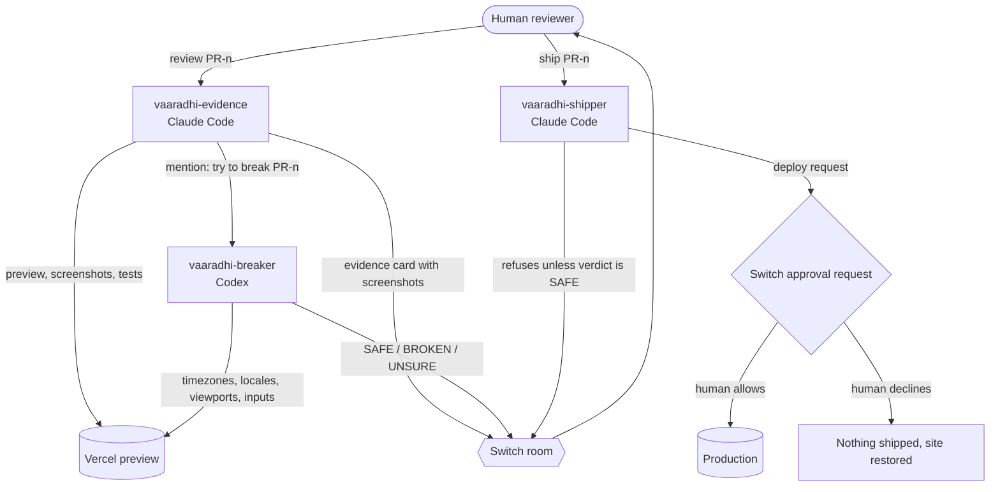

# Vaaradhi

Vaaradhi is a Switch room where a reviewer checks proof instead of reading an AI-written diff. When a change comes in, one agent runs it, deploys a preview, takes screenshots, runs the tests and explains the change in plain language with a risk level. A second agent from a different AI vendor then tries to break it. The human reads one evidence card and one verdict, and decides whether it ships. Nothing reaches production until that human asks for it and approves the deploy in the room.

We built it for the Flip the Switch hackathon (WeMakeDevs x Switch AI). The name means "bridge" in Telugu.

## The problem

AI coding agents have made code cheap to write. Reviewing it has not become any cheaper, and several recent reports say review is now where teams get stuck. We checked each figure below against the linked page on 5 Nov 2026:

- A Harvard study of about 700 firms found 30 percent more code and 23 percent more pull requests, but no more finished work, with review time up 49 percent, as reported by [Dromeas](https://dromeas.ai/blog/ai-coding-agents-code-review-bottleneck).
- Qodo's [State of AI Code Quality 2026](https://www.qodo.ai/blog/state-of-ai-code-quality-report-2026/) report names reviewing AI-generated code as the top bottleneck for both developers and engineering leaders.
- [QA.tech](https://qa.tech/blog/code-review-bottleneck-ai-generated-code) cites Faros AI data showing median review taking five times longer, and discusses the DORA "verification tax".
- [InfoQ](https://www.infoq.com/news/2026/10/survey-complex-codebases-agents/) reported in October 2026 that 35 percent of generated code reaches production before the team understands it.
- In the 2025 Stack Overflow Developer Survey, 66 percent of developers named "AI solutions that are almost right, but not quite" as their biggest frustration, as reported by [admin-it](https://www.admin-it.io/stack-overflow-survey-66-of-developers-frustrated-by-ai-inaccuracy/). PR-2 in our demo is exactly that kind of change.

Reading a diff tells a reviewer what changed. It does not tell them whether the change works for every user. That second question is the one Vaaradhi tries to answer with evidence.

## How it works

Three agents share one Switch room with the human reviewer.

**vaaradhi-evidence** runs on Claude Code. When the reviewer says `review PR-n`, it copies the live site, applies the change, runs the tests, deploys a Vercel preview and takes mobile and desktop screenshots of both the preview and production. It then posts one evidence card: what the change claims, what actually changed in plain language, the files touched, the test results, the preview link, the before and after screenshots, a risk level of LOW, MEDIUM or HIGH with a reason, and the time taken. Finally it mentions the breaker.

**vaaradhi-breaker** runs on Codex, so a model from a different vendor checks the first agent's work. Its job is to break the change, not to agree with it. It compares preview and production, checks two screen sizes, three timezones and a non-English locale, reasons about edge inputs for any form the change touches, and posts a verdict that starts with SAFE, BROKEN or UNSURE.

**vaaradhi-shipper** runs on Claude Code and only listens to the reviewer. When the reviewer says `ship PR-n`, it checks that the change was reviewed and that the breaker's latest verdict starts with SAFE. If not, it refuses. If so, it applies the change and runs the production deploy, which Switch holds behind an approval request until the reviewer allows it. It then posts the live link, a fresh screenshot and the timings.



The demo app is ShipFest 2026, a small fictional hackathon website with a countdown and a submission form. Three AI-written changes are prepared in `changes/`. Each one comes with a confident pull request description, the way coding agents usually describe their own work.

## How Switch is used

Switch is the place where the whole workflow happens. We used these features:

| Switch feature | How Vaaradhi uses it |
| --- | --- |
| Shared room | All three agents and the reviewer work in one private Mattermost channel that Switch turns into a room. |
| Agents from two vendors | Evidence and shipper run on Claude Code, the breaker on Codex, side by side in the same room. |
| Agent to agent handoff by mention | The evidence agent hands the change to the breaker by mentioning `@vaaradhi-breaker` with the preview link. |
| Image attachments | The evidence card and the breaker's verdict carry screenshots as images in the room. |
| Who can talk to the agent | Evidence and breaker accept their owner and the owner's agents, so they can hand work to each other. The shipper is set to only me, so no agent can ask it to ship. |
| Approval requests with allow and decline | Every production deploy waits for the reviewer to allow or decline it in the room. If a deploy is declined, the shipper is instructed to restore the site. We have not tested the decline path yet. |
| Auto mode off | The shipper runs with auto mode off, so its commands go through the approval request. |
| switch-buddy | The Switch helper agent helped us set up the agents and fixed a stale session lock that left an agent silent (see Limitations). |
| Templates | `vaaradhi.template.yaml` creates the three agents and the private review room in one step. |

## Results

We ran the same three changes twice. PR-1 makes the main button easier to tap on phones. PR-2 claims to fix the countdown. PR-3 lets teams of four submit.

### Run 1, 5 Nov 2026

| PR | Tests | Evidence risk | Evidence time | Breaker verdict | Breaker time | Outcome | Review to live |
| --- | --- | --- | --- | --- | --- | --- | --- |
| PR-1 | 12 passed, 0 failed | LOW | 02:30 | SAFE | 02:10 | Shipped | 14:02 |
| PR-2 | 12 passed, 0 failed | HIGH | 04:29 | BROKEN | 08:00 | Blocked: shipper refused | not shipped |
| PR-3 | 13 passed, 0 failed | MEDIUM | 16:16 | v1 BROKEN, then v2 SAFE | 01:50 (v2) | Shipped | 41:08 |

### Run 2, 6 Nov 2026

| PR | Tests | Evidence risk | Evidence time | Breaker verdict | Breaker time | Outcome | Human decision | Review to live |
| --- | --- | --- | --- | --- | --- | --- | --- | --- |
| PR-1 | 12 passed, 0 failed | LOW | 01:24 | SAFE | 02:46 | Shipped | 139 s | 08:31 |
| PR-2 | 12 passed, 0 failed | HIGH | 01:03 | BROKEN | 01:29 | Blocked: shipper refused, production unchanged | n/a | not shipped |
| PR-3 | 13 passed, 0 failed | MEDIUM | 00:40 | SAFE (no false alarm) | 01:42 | Shipped | 72 s | 05:13 |

Times are minutes and seconds. Evidence time runs from the review request to the evidence card. Review to live runs from the review request to the production deploy. Human decision runs from the breaker's verdict to the reviewer's `ship PR-n` message.

### Run 1 compared with Run 2

| Measure | Run 1 (5 Nov) | Run 2 (6 Nov) |
| --- | --- | --- |
| Evidence time PR-1 / PR-2 / PR-3 | 02:30 / 04:29 / 16:16 | 01:24 / 01:03 / 00:40 |
| Breaker time PR-1 / PR-2 / PR-3 (self-reported) | 02:10 / 08:00 / 01:50 (v2) | 02:46 / 01:29 / 01:42 |
| Review to live PR-1 / PR-3 | 14:02 / 41:08 | 08:31 / 05:13 |
| Human decision PR-1 / PR-3 | not measured | 139 s / 72 s |
| Broken changes caught | 1 of 1 (PR-2) | 1 of 1 (PR-2) |
| Broken changes shipped | 0 | 0 |
| False alarms | 1 (PR-3, breaker v1) | 0 |
| Tests that caught PR-2 | 0 of 12 | 0 of 12 |

### What the numbers do and do not show

The test suite never caught PR-2. It passed all 12 tests in both runs. In Run 2 the evidence agent showed that, at the real deadline, production correctly says submissions are closed while a visitor in New York sees 10 hours 30 minutes left on the PR-2 preview. The breaker marked it BROKEN in both runs, and the shipper refused to ship it.

Breaker times are the breaker's own reported working time. The gap between the evidence card and the verdict is longer, 04:03 for PR-1 and 02:49 for PR-3 in Run 2, because it also includes the handoff and the session starting.

Human decision time includes reading the evidence card and the breaker's verdict, not only typing `ship PR-n`. We did not measure it in Run 1.

Run 1's PR-3 times include a stuck agent session and a re-run of the breaker, so the drop from 41:08 to 05:13 overstates the normal improvement.

Several things changed between the runs: Run 2 used Sonnet for the evidence and shipper agents (Run 1's model was not recorded), a fresh room, the breaker's new severity rubric, and improved shipper instructions and screenshot script. With only two runs we cannot say which of these made the difference.

In Run 1, PR-1's evidence card reported 02:10 while its timing file gives 02:30. The tables use the timing file. Full details and raw timestamps are in [`docs/EVAL.md`](docs/EVAL.md).

## Reproduce it on Windows

We built and tested this on one Windows 11 laptop. These are the versions we used:

| Tool | Version |
| --- | --- |
| Node.js | 22.16.0 |
| Claude Code | 2.1.318 |
| Codex CLI | 0.166.0 |
| Switch Console | 0.40.1 |
| Switch server | 0.31.0 |
| Docker Desktop (for the bundled Mattermost) | 29.9.2 |
| Vercel CLI | 65.11.0 |
| Google Chrome | 156.0.8078.80 |
| Playwright (installed by the setup script) | 1.64.1 |

You also need a Vercel account, and Claude Code and Codex signed in. In Switch Console, both should read **Signed in** under **Settings > Agent providers**.

**1. Create the workspaces.** Pick a Vercel project name; your production URL will be `https://<name>.vercel.app`. From the repo folder, run:

```powershell
powershell -ExecutionPolicy Bypass -File .\setup-workspaces.ps1 -ProductionUrl https://<name>.vercel.app
```

This creates `C:\VaaradhiAgents\team` and `C:\VaaradhiAgents\breaker`, fills in your paths and URL in the agent instructions, copies the demo site and the three changes, and installs Playwright without downloading a browser. It uses the Chrome you already have. Add `-AgentsRoot D:\Somewhere` to use another folder. It refuses to overwrite a folder that already exists.

**2. Link your own Vercel project and deploy the starting site.**

```powershell
cd C:\VaaradhiAgents\team\site
vercel link
vercel deploy --prod
```

If Vercel gives you a different production URL, delete the workspace folder and run step 1 again with the real one.

**3. Turn off preview deployment protection.** In the Vercel dashboard, open your project, then **Settings > Deployment Protection**, set **Vercel Authentication** to disabled and save. Otherwise the agents screenshot a login page instead of the preview.

**4. Let Codex reach the internet from the breaker's folder.** In `%USERPROFILE%\.codex\config.toml`, put the first line at the very top of the file, above any section header, and add the section:

```toml
sandbox_mode = "workspace-write"

[sandbox_workspace_write]
network_access = true
```

This applies to every Codex session on the machine, not only the breaker.

**5. Create the agents and the room.** In Switch Console, open **Templates**, choose **Import template** and paste `vaaradhi.template.yaml`. Then choose **Use** and fill in the team folder (`C:\VaaradhiAgents\team`), the breaker folder (`C:\VaaradhiAgents\breaker`), the computer and the messaging app. This creates the three agents and a private room called `vaaradhi-review`.

**6. Check that Switch is ready.** In the room, send:

```text
!list-agents
```

Switch answers this itself. When it replies with all three agents, the server is up. After restarting Switch Console this can take a few minutes, so wait for the reply before asking agents to work.

**7. Review and ship.** In the room:

```text
@vaaradhi-evidence review PR-1
```

Wait for the evidence card and the breaker's verdict. If the verdict starts with SAFE:

```text
@vaaradhi-shipper ship PR-1
```

Allow the approval requests that appear in the room. Then try PR-2 and PR-3 the same way.

**8. Reset for another run.** `reset-all.ps1` archives the evidence and screenshots into `runs\`, empties the working folders, puts the original demo site back and deploys it to production so the original bugs are live again. Pass the same workspace folder and production URL you used in step 1:

```powershell
powershell -ExecutionPolicy Bypass -File .\reset-all.ps1 -AgentsRoot C:\VaaradhiAgents -ProductionUrl https://<name>.vercel.app
```

`-AgentsRoot` defaults to `C:\VaaradhiAgents` and `-ProductionUrl` defaults to our own site, so always pass your URL. Before changing anything, the script checks that `team\site` is linked to the Vercel project behind that URL, and refuses to continue if it is not.

## What we learned, and the limits

The incoming changes are prepared in advance rather than written live by an author agent. That kept the demo repeatable, but it means we have not tested Vaaradhi on changes nobody has seen before.

The screenshot script can load pages, set the screen size, timezone, locale and clock, and save screenshots. It cannot type into forms, so the breaker checks form edge cases by reading the form's HTML and validation code, and says so in its verdict.

Everything was tested on one Windows laptop. We did not test approval from a phone or through Telegram, so we make no claim about either.

Our first breaker was too eager. In Run 1 it marked PR-3 BROKEN because of a 17-digit decimal that no real user would type. We added a severity rubric: BROKEN only for realistic failures that cause harm, such as wrong information, a blocked action, lost data or a broken layout. Theoretical edge cases now go in a "Minor notes" line under SAFE. We also told it to read the form's own input constraints first. In Run 2 it raised no false alarms and still caught PR-2.

We also hit a few Switch and Windows issues, all recorded in [`docs/BUILD_LOG.md`](docs/BUILD_LOG.md):

- The Codex sandbox blocked the breaker's browser at first, with `net::ERR_NETWORK_ACCESS_DENIED`. The `network_access` setting in step 4 fixed it. The breaker later also hit a permission error on Windows temp files, so its screenshot script now keeps temp files inside its own `shots` folder.
- After restarting Switch Console, the local server took a few minutes to come back. Waiting for `!list-agents` to reply became our ready check.
- After Switch Console quit, Windows reused a process number, so a stale session lock looked alive. The evidence agent retried silently every 2 minutes until switch-buddy renamed the lock note.
- The shipper never sees the approval wait, because Switch enforces it outside the agent. It wrongly concluded that its deploy had skipped approval. We fixed this in its instructions.

## A note for judges

[`docs/CHANGES_ANSWER_KEY.md`](docs/CHANGES_ANSWER_KEY.md) explains which prepared change is broken and how to prove it. It is for judges only. The setup script never copies it into the agent workspaces, and the agents work only inside those workspaces, so they never see it.

## Demo and blog

- Demo video: _link coming soon_
- Blog post: _link coming soon_
